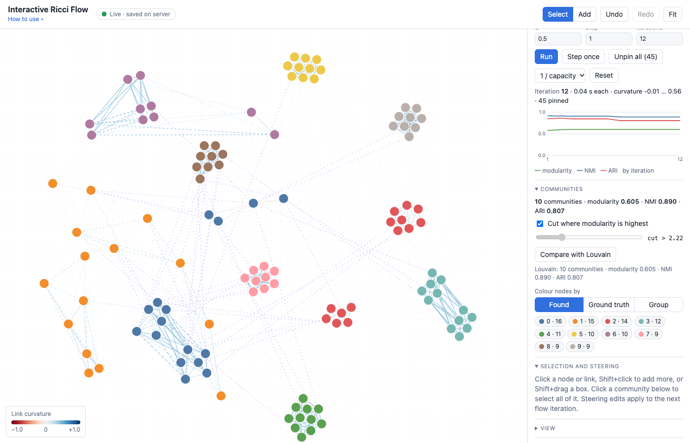
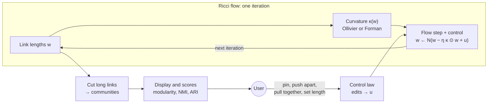

# Interactive Ricci Flow

> ### *Ricci-flow community detection you can watch and steer*

<sub>Repository: InteractiveGraphVizFramework, which started in 2018 as a general interactive graph editor.</sub>

An interactive web tool for Ricci-flow community detection, and a framework for experimenting with the method. In the page you load a network (a classic dataset, a synthetic benchmark or your own file), run Ricci flow on it with Ollivier-Ricci or Forman-Ricci curvature, and watch communities pull apart as the links between them stretch. While the flow runs you can steer it: pin links, push a group away from the rest, pull a group together, change any link. Results are scored against the ground truth when there is one.

The computation is a small Python package. Change the curvature, the flow update or the community cut, run the local server, and the page, the steering and the scores all use your version; see [Changing the method](#changing-the-method).


[](LICENSE)


<sub>College football after 12 Ollivier-Ricci flow iterations: 10 communities found (NMI 0.89 against the real conferences). Links inside a community stay solid; links the flow stretched turn dotted; purple links were pinned by hand.</sub>

**Live demo:** https://ibipul.github.io/InteractiveGraphVizFramework/. It runs the Python code in your browser on small graphs. For the real datasets, larger graphs and live steering shared between several people, use the Quick start below.

## Quick start

```bash
git clone https://github.com/ibipul/InteractiveGraphVizFramework.git
cd InteractiveGraphVizFramework
./run.sh
```

Requires Python 3.11 or newer. The first run creates a virtual environment in `.venv` and installs the pinned packages from `requirements.txt`. The page then opens at **http://localhost:8070**, or the next free port; the terminal prints the address. Keep the terminal open while you use the page, and press Ctrl+C there to stop.

Then, in the page: pick **College football** under **Graph**, press **Load**, then **Run** under **Ricci flow**.

## Method at a glance



The tool treats Ricci flow as a feedback loop. The flow is the system being steered, and the person at the screen closes the loop.

- **Flow.** Each iteration computes the curvature κ of every link from the current lengths w, then updates them: w ← N(w − η κ ⊙ w + u). Here η is the step size, ⊙ multiplies link by link, u is the control input and N rescales the free lengths so the total stays fixed. Bridges between groups (κ < 0) stretch; links inside groups (κ > 0) shrink.
- **Output.** Cutting links longer than a threshold gives the communities, scored by modularity and, when there is ground truth, by NMI and ARI.
- **Control.** User edits become the input u. Today every edit is a hard pin: the link's length is set and held. That is the limit k → ∞ of the soft-pin law u = −k(w − w_ref).

### How to cite

If you use this software, or results obtained with it, please cite it. GitHub's **Cite this repository** button (in the right sidebar) gives the same details from [CITATION.cff](CITATION.cff).

> Islam, B. (2026). *Interactive Ricci Flow* (Version 0.1.0) [Computer software]. https://github.com/ibipul/InteractiveGraphVizFramework

```bibtex
@software{islam_interactive_ricci_flow_2026,
  author  = {Islam, Bipul},
  title   = {Interactive Ricci Flow},
  version = {0.1.0},
  year    = {2026},
  url     = {https://github.com/ibipul/InteractiveGraphVizFramework},
  note    = {ORCID: 0009-0002-5209-7572}
}
```

### In development

| Area | Approach | Rule |
|---|---|---|
| Control laws | Soft pin | u = −k(w − w_ref); k → ∞ gives today's hard pin |
| | Curvature target, for marking bridges or same-group links | u = −k(κ − κ_ref) |
| | Group objective over must-link and cannot-link pairs | u = −k ∇J |
| | Control barrier function filter: the smallest u that keeps a length above a floor | w_e ≥ τ |
| | Fading gain: does the network keep the edit once it is released? | k_t = k₀λᵗ |
| Normalization | Subtract the mean curvature instead of rescaling afterwards; keeps the total length exactly and leaves u alone | w ← w · (1 − η(κ − κ̄)), κ̄ = Σκw / Σw |
| | Log-space form; also keeps every length positive at any step | w ← w · exp(−η(κ − κ̄)) |
| Step size | Cap the change per step, with c set by a step-halving test; targets the oscillation seen with the Ollivier default η = 1 | clip η(κ − κ̄) to [−c, c] |
| Edits | Rescale free links to their own previous total, so an edit no longer shrinks or grows every other link | scale = Σ free before / Σ free proposed |
| Communities | Keep the previous cut threshold unless a new one raises modularity by a set margin | |
| Evaluation | Accuracy against total control effort, scored on links and nodes the user did not touch; several seeds (mean ± sd); Louvain, Leiden, Infomap and spectral baselines; LFR sweep over μ; simulated users | NMI, ARI vs Σ‖u_t‖ |

---

## Contents

- [Features](#features)
- [Using the page](#using-the-page)
- [Comparing with the ground truth](#comparing-with-the-ground-truth)
- [Steering the flow](#steering-the-flow)
- [Datasets](#datasets)
- [Importing your own network](#importing-your-own-network)
- [How it works](#how-it-works)
- [What to expect](#what-to-expect)
- [Web demo and full version](#web-demo-and-full-version)
- [Running from Python](#running-from-python)
- [Graph file format](#graph-file-format)
- [Project structure](#project-structure)
- [Configuration](#configuration)
- [Development](#development)
- [Changing the method](#changing-the-method)
- [What changed from the 2018 version](#what-changed-from-the-2018-version)
- [Troubleshooting](#troubleshooting)
- [References](#references)
- [License](#license)

## Features

- **Two curvatures.** Ollivier-Ricci (optimal transport between neighbourhoods; accurate) and augmented Forman-Ricci (a local formula; fast and rough). The values match the [GraphRicciCurvature](https://github.com/saibalmars/GraphRicciCurvature) package.
- **Ricci flow with community detection.** Each iteration stretches negatively curved links and shrinks positively curved ones. Communities come from cutting the long links, at the cut with the highest modularity or one you choose.
- **Steering.** Pin links, set lengths, pull groups together or push them apart while the flow runs; the next iteration builds on your change.
- **Ground truth.** NMI and adjusted Rand index after every iteration, a chart of both over time, a Louvain baseline, a found-vs-truth table, a Mismatches view, and colours matched so found communities and true classes look alike where they agree. Clicking a node shows its found community and its true class together.
- **Datasets.** Karate club, political books, college football, email-Eu-core, Cora, stochastic block models and LFR benchmarks, plus import of edge lists (with capacities), GraphML, GML and JSON.
- **2D and 3D views.** The flat view has every editing gesture; the 3D view (WebGL) lets you rotate around the communities as they separate.
- **Live and shared.** Every change is saved on the server and pushed to every open tab, so several people can steer the same run.
- **Results.** Download the graph with lengths, curvature and communities as JSON and CSV, or save them on the server.
- **Web demo.** With no server, the page runs the same Python package in the browser through [Pyodide](https://pyodide.org).
- **Graph editor.** Add and delete nodes and links, change loads, undo and redo.

## Using the page

Under the title in the top bar:

- **How to use** opens a card with the mouse and keyboard controls (it opens by itself on your first visit).
- **View** opens the display settings: curvature colours, dotted long links, whether the layout follows the Ricci lengths, labels.
- **About this graph** appears once a graph is loaded (it pulses when you load a new one). It explains what the nodes, links and ground truth are, what Ricci flow does with the chosen curvature, what to expect on this graph, a reference result, and where the current run stands.

The side panel, top to bottom:

1. **Graph.** Pick a dataset (synthetic ones take parameters), press **Load**. **Import file…** reads your own network. **Download results** saves the graph with lengths, curvature and communities, plus node and edge tables. **Save on server** writes the same into `data/results/<time>-<name>/`.
2. **Ricci flow.** Choose the curvature. `α` is the share of each node's mass that stays put (Ollivier only), `Step` how far each iteration moves the lengths (default 1 for Ollivier, 0.3 for Forman), `Iterations` how many to run (0 runs until you press **Stop**). **Run** / **Stop** (Space), **Step once** (S). **Unpin all** (Shift+P) releases every pinned link and every node you dragged into place, keeping the current lengths. **Reset** sets every length back to its starting value (1 / capacity, capacity, or all 1) and unpins all links and nodes. The chart shows modularity, NMI and ARI by iteration.
3. **Communities.** The count, modularity and, with ground truth, NMI and ARI. Untick **Cut where modularity is highest** to choose the cut length with the slider. **Compare with Louvain** scores Louvain's communities the same way. Colour nodes by the **Found** communities, the **Ground truth**, the **Mismatches**, or the editor **Group**. Click a community chip to select all of its nodes. With ground truth, the **Found vs ground truth** table follows (see [Comparing with the ground truth](#comparing-with-the-ground-truth)).
4. **Selection and steering.** Details of what you selected and the steering buttons (next section).

On the canvas:

| Action | What it does |
|---|---|
| Click | Select a node or link |
| Shift + click | Add to or remove from the selection |
| Shift + drag | Select every node in a box |
| Drag a node | Move it (and the rest of the selection); it stays pinned in place |
| Double-click a node | Release it |
| Drag empty space, wheel | Pan, zoom |
| **Add** mode (<kbd>N</kbd>) | Click to add a node, drag from node to node to add a link; **Select** mode is <kbd>V</kbd> |
| <kbd>[</kbd> / <kbd>]</kbd> | Pull the selection together / push it apart |
| <kbd>P</kbd> | Pin or unpin the selection's links |
| <kbd>Shift</kbd>+<kbd>P</kbd> | Unpin all links and nodes |
| <kbd>A</kbd> / <kbd>D</kbd> | Increase / decrease load |
| <kbd>Delete</kbd> | Remove the selection |
| <kbd>F</kbd>, <kbd>Esc</kbd> | Fit the view, clear the selection |
| <kbd>Ctrl/⌘</kbd>+<kbd>Z</kbd>, <kbd>Ctrl/⌘</kbd>+<kbd>Shift</kbd>+<kbd>Z</kbd> | Undo, redo (not while the flow runs) |

**2D / 3D** in the top bar switches views (remembered in your browser). In 3D, drag to rotate, scroll to zoom, hover a node for its name, click to select (Shift+click adds), click empty space to clear. Steering buttons and keys work the same. Add mode and box select are 2D only. In 3D, links fade instead of turning dotted as the flow stretches them, and a clicked node's groups are shown by colour (green: in both, blue: only in the found community, orange: only in the true class) instead of rings. The 3D library (about 1.2 MB) loads the first time you switch.

What you see: node colour is the community; link colour is curvature (red negative, blue positive); a link gets more dotted the more the flow has stretched it (compared with the median length); purple links are pinned. With **Layout follows Ricci lengths** on, each link pulls its ends towards its Ricci length, so communities drift apart as the flow runs.

## Comparing with the ground truth

Three views answer "how do the found communities relate to the true ones?":

- **Matched colours.** Each found community takes the colour of the true class it overlaps most, matched one-to-one (the best total overlap). Switching between **Found** and **Ground truth** then looks the same wherever the two agree, and only the differences change colour. Found communities left without a match (when there are more found communities than classes) get colours of their own; single-node communities are grey.
- **Click a node.** Nodes in its found community get a solid ring, nodes in its true class a dashed ring, and everything else fades. The selection panel shows both groups with their sizes ("12 in both · 4 only in the found community · 1 only in the ground truth") and a **Select** button for each.
- **Found vs ground truth table.** Rows are found communities (largest 10, the rest folded into one row), columns are true classes (largest 8, the rest folded into "…"); each cell counts the nodes in both, shaded by its share of the row. The last column is the row's main class and its share. Click a cell to select those nodes. Above the table, **purity** is the share of nodes that belong to their community's main class.
- **Mismatches** colouring fades the nodes that agree and shows, in their true class's colour with a red ring, the nodes whose true class differs from the main class of their found community. Each community chip shows how many of its nodes differ.

## Steering the flow

Every steering action is an ordinary edit, so it works while the flow runs, from any open tab:

| Action | Effect |
|---|---|
| **Pull together** <kbd>[</kbd> | Halves the length of the links inside the selection and pins them |
| **Push apart** <kbd>]</kbd> | Doubles the length of the links leaving the selection and pins them (for a selection of links only: those links) |
| **Pin links** <kbd>P</kbd> | The flow stops changing those links |
| **Unpin all** <kbd>Shift</kbd>+<kbd>P</kbd> | Releases every pinned link (and every dragged node); the flow takes over again from the current lengths |
| Set a link's **Length** | Sets it and pins it |
| Set a link's **Capacity** | Used by **Reset** with 1 / capacity or capacity |
| Delete or add nodes and links | The next iteration runs on the new graph |

"Inside the selection" means the selected links plus every link with both ends among the selected nodes. A useful pattern: run the flow, click a community chip, then push it apart or pull it together and watch the next iterations.

How an edit meets a running flow: each iteration reads the current lengths, computes curvature (the slow part), then writes the new lengths back. A link keeps its current length, instead of taking the flow's update, if it is pinned or if someone changed it while that iteration was computing. The remaining links take the update and are rescaled so all lengths still add up to the number of links. One flow run is one undo step.

## Datasets

| Dataset | Nodes | Links | Ground truth | Source | Web demo |
|---|---|---|---|---|---|
| Karate club | 34 | 78 | the club each member joined after the split | built into networkx | yes |
| Political books | 105 | 441 | political leaning (3) | [Newman's network data](https://public.websites.umich.edu/~mejn/netdata/) | – |
| College football | 115 | 613 | conference (11 conferences plus independents) | [Newman's network data](https://public.websites.umich.edu/~mejn/netdata/) | yes |
| email-Eu-core | 1,005 | 16,064 | department (42) | [SNAP](https://snap.stanford.edu/data/email-Eu-core.html) | – |
| Cora | 2,708 | 5,278 | paper topic (7) | [tkipf/pygcn](https://github.com/tkipf/pygcn) copy of the LINQS data | – |
| Stochastic block model | you choose | | the planted blocks | `networkx.stochastic_block_model` | up to 600 nodes |
| LFR benchmark | 50 – 2,000 | | the planted communities | `networkx.LFR_benchmark_graph` | up to 600 nodes |

The real networks are downloaded on first use and cached in `data/datasets/`, except college football: a converted copy ships in `web/datasets/football.json` so the web demo, which can't download from other sites, can load it too. Link counts are after merging directed or repeated edges and dropping self-loops. Cora's topics follow its links only loosely, so expect low scores there from any method.

networkx's LFR generator often gives up for a given seed ("could not assign communities"); the loader then tries the next 24 seeds. Above 2,000 nodes it rarely succeeds, so the panel stops there.

Very large networks such as SNAP's com-Amazon or com-DBLP (hundreds of thousands of nodes) are not included: Forman-Ricci would compute them, but the page cannot lay out and draw that many nodes live.

## Importing your own network

**Import file…** takes:

| Format | Extensions | Notes |
|---|---|---|
| Edge list | `.csv` `.tsv` `.txt` `.edges` `.edgelist` `.dat` | One link per line: source, target, optional capacity; separated by commas, tabs, semicolons or spaces. A header row is optional; with one, the capacity column may be named `capacity`, `cap`, `weight` or `w`. Lines starting with `#` or `%` are skipped. |
| GraphML | `.graphml` | Link attribute `capacity` (or `weight`) is the capacity. A node attribute named `truth`, `community`, `block`, `club`, `value`, `label_true` or `class` on every node is the ground truth. |
| GML | `.gml` | As GraphML. |
| JSON | `.json` | This app's format (below), or networkx node-link JSON. |

Node names can be anything; they are kept as labels. Directed links and repeated links between the same two nodes are merged into one link whose capacity is the sum, and self-loops are dropped; the message after the import says how many.

**Capacities and lengths.** Ricci flow works on link *lengths* (distances). A capacity is the opposite (a stronger connection), so the starting length of each link is 1 / capacity, scaled so the average length is 1. Use **Reset** with *capacity* or *all 1* to start from the capacity itself or to ignore it.

## How it works

**Ollivier-Ricci curvature.** Give every node a small probability cloud: it keeps a share `α` of the mass itself and spreads the rest over its neighbours, more to closer ones (in proportion to exp(−length²)). The curvature of a link x–y compares the cost of moving x's cloud onto y's cloud (optimal transport, where moving mass costs the shortest-path distance) with the distance between x and y:

```
curvature(x, y) = 1 − transport cost(cloud x → cloud y) / distance(x, y)
```

Inside a tightly knit group the two clouds overlap, the transport is cheap and the curvature is positive. On a bridge between groups the clouds are far apart and the curvature is negative. This needs the shortest-path distance between every pair of nodes, so it is limited to graphs of up to 6,000 nodes. Transport problems are solved with POT's network simplex (scipy's HiGHS solver in the browser).

**Forman-Ricci curvature (augmented).** A formula that only looks at a link's two ends: on an unweighted graph it is `4 − degree(x) − degree(y) + 3 × triangles(x, y)`. Its weighted version treats a weight as connection strength, so the flow gives it 1 / length. It is fast enough for any size, but it is a rougher signal, dominated by degrees.

**Ricci flow** (Ni et al. 2019). Each iteration computes the curvature and updates every link:

```
length ← length − step × curvature × length
```

then rescales all lengths so they add up to the number of links. Negatively curved links (bridges) grow, positively curved ones shrink.

For the Forman flow, three choices made for this project (not taken from a paper):

- **Weights are strengths.** Forman gets weight = 1 / length. Feeding it the lengths themselves is a feedback loop: a link the flow stretches looks even more negatively curved and stretches further, and in testing every graph collapsed to a single community within about 150 iterations.
- **Degree normalization.** The curvature is divided by `degree(x) + degree(y)`, then by its largest absolute value, which puts it in [−1, 1] like Ollivier's. Without the degree division the flow mostly reflects degrees and found no communities in stochastic block models.
- **Bounded lengths.** Lengths stay between 0.01 and 100 times the average, with a smaller default step (0.3).

With these, Forman results hold steady from 20 to 400 iterations in testing.

**Communities** ("surgery"). Cut every link longer than a threshold; the connected pieces are the communities. By default the threshold is the one, among lengths from the median to the longest link, that gives the highest modularity. Communities are numbered by size, 0 being the largest.

**Scores.** Modularity (Newman, on the unweighted graph) measures how well the communities follow the links. With ground truth, NMI (normalized mutual information, arithmetic-mean normalization as in scikit-learn) and ARI (adjusted Rand index) measure agreement with it: 1 is a perfect match, around 0 is chance.

**Live updates.** The page keeps one WebSocket open to the server. Each edit is a small message such as `{"op": "scale", "links": [[3, 7]], "factor": 2}`; the server applies it, saves the graph to `data/graph.json`, and sends the new state to every open tab. While the flow runs, it runs on a background thread and the tabs get the state after each iteration (at most four times a second).

## What to expect

Measured on an Apple M3 Pro with the default settings (α = 0.5, starting lengths all 1, automatic cut). NMI is against the ground truth; Louvain is networkx's, seed 0, for comparison.

| Graph | Curvature | Iterations | Time | Communities | NMI | ARI | Louvain NMI |
|---|---|---|---|---|---|---|---|
| Karate club | Ollivier | 20 | 0.3 s | 4 | 0.491 | 0.385 | 0.588 |
| Political books | Ollivier | 20 | 0.8 s | 4 | 0.554 | 0.665 | 0.504 |
| College football | Ollivier | 20 | 1.0 s | 10 | 0.890 | 0.807 | 0.890 |
| College football | Forman | 20 | 0.3 s | 16 | 0.916 | 0.853 | 0.890 |
| SBM, 5 blocks of 40 (p_in 0.3, p_out 0.02) | Ollivier | 20 | 2.7 s | 5 | 1.000 | 1.000 | 1.000 |
| SBM, same | Forman | 20 | 0.4 s | 6 | 0.725 | 0.467 | 1.000 |
| LFR, 500 nodes, μ = 0.2 | Ollivier | 20 | 4.9 s | 12 | 0.972 | 0.971 | 0.978 |
| email-Eu-core | Ollivier | 10 | 17.8 s | 103 | 0.377 | 0.030 | 0.569 |
| Cora | Forman | 20 | 0.9 s | 608 | 0.399 | 0.074 | 0.441 |

In short: Ollivier-Ricci flow recovers planted communities well and matches Louvain on football and LFR. Forman is much faster and does as well on football, but is clearly weaker on the block model, and finds no communities in noisier block models or LFR graphs where the Ollivier flow does. On email-Eu-core and Cora the automatic cut leaves many small pieces. The cut threshold is where steering and the manual slider help most.

## Web demo and full version

| | Web demo (GitHub Pages) | Full version (`./run.sh`) |
|---|---|---|
| Where Python runs | in your browser (Pyodide) | the local server |
| First load | downloads about 35 MB (cached afterwards); about 6 s on a fast connection | – |
| Graphs | karate club, college football, SBM and LFR up to 600 nodes, imports up to 600 nodes | everything above |
| Curvature | both; Ollivier uses scipy's slower solver (about 3.6 s per iteration on a 200-node, 1,540-link SBM, versus 0.13 s natively) | both |
| Sharing | one visitor, results stay in the browser until downloaded | every open tab shares the same live graph; results saved on disk |

The page decides by itself: it tries the server's WebSocket and, if nothing answers, starts Python in the browser. Add `?demo` to the address to force the web demo even when a server is running.

The [`pages`](.github/workflows/pages.yml) workflow publishes `web/` and the Python package to GitHub Pages on every push to `master`. It needs a one-time switch in the repository settings: **Settings → Pages → Build and deployment → Source: GitHub Actions**.

## Running from Python

The curvature and flow work without the page:

```python
import networkx as nx
import numpy as np
from interactive_graph import ricci

g = nx.karate_club_graph()
edges = np.array(g.edges())
arrays = ricci.EdgeArrays(list(g.nodes()), edges[:, 0], edges[:, 1], capacity=np.ones(len(edges)))

kappa = ricci.ollivier_ricci(arrays, np.ones(len(edges)))          # or ricci.forman_ricci
result = ricci.ricci_flow(arrays, iterations=20, method="ollivier", init="uniform")
comms = ricci.find_communities(arrays, result.length)
print(comms.count, comms.modularity)
```

`interactive_graph.datasets.load("football")` returns any of the datasets above in this app's format, and `interactive_graph.session.Session` drives everything the page does (`handle(op)` and `iterate()`). `ricci.compare_to_truth(labels, truth, n_classes)` gives the found-vs-truth table, main classes, purity and matched colours.

## Graph file format

The same JSON shape is used on disk, for downloads and imports:

```json
{
  "nodes": [
    {"id": 0, "label": "BrighamYoung", "truth": 7, "community": 2, "nval": 1, "current": 0, "total": 1}
  ],
  "links": [
    {"source": 0, "target": 4, "capacity": 2.0, "length": 0.84, "curvature": 0.31, "pinned": true,
     "lval": 1, "current": 0, "total": 1}
  ],
  "meta": {"name": "College football", "truth_names": ["0", "1", "..."], "truth_label": "conference"}
}
```

| Field | Meaning |
|---|---|
| `id` | Node id, a whole number |
| `label` | The original node name |
| `truth`, `community` | Ground-truth and found community (numbers; `meta.truth_names` holds the names) |
| `capacity`, `length` | Link capacity and Ricci length |
| `curvature` | The link's curvature at the last iteration (raw Forman values are not normalized) |
| `pinned` | The flow leaves this link's length alone |
| `nval`, `lval`, `current`, `total`, `x`, `y` | Editor fields: group, weight, load counters and starting position |

Links are undirected and stored with `source < target`. `web/examples/` has two graphs from the original project in this format.

## Project structure

```
interactive_graph/
  ricci.py       Ollivier and Forman curvature, Ricci flow, communities, NMI/ARI, truth comparison, Louvain
  session.py     one session: graph edits, the steerable flow loop, results (used by server and browser)
  graph.py       the graph state, every edit, undo/redo
  datasets.py    built-in, downloaded and synthetic graphs with ground truth
  importer.py    edge list, GraphML, GML and JSON import
  server.py      FastAPI app: the page, the /ws WebSocket, import, save, flow thread
web/
  index.html, app.css, app.js   the page: canvas drawing (D3 force layout), panels, gestures
  view3d.js      the 3D view (3d-force-graph / three.js), loaded on first use
  py-worker.js   the web demo: runs interactive_graph under Pyodide in a worker
tests/           pytest tests: reference curvature values, flow, steering, import, server
run.sh           one-command setup and launch
```

## Configuration

Set these environment variables in front of `./run.sh`:

| Variable | Default | Meaning |
|---|---|---|
| `PORT` | first free port from 8070 | Use exactly this port |
| `GRAPH_FILE` | `data/graph.json` | Where the live graph is saved |
| `PYTHON` | first Python 3.11+ found | The Python used to create `.venv` |
| `NO_BROWSER` | unset | Set to anything to not open a browser |

## Development

```bash
.venv/bin/pip install -r requirements-dev.txt
.venv/bin/python -m pytest
```

To run the server with auto-reload while editing:

```bash
.venv/bin/uvicorn interactive_graph.server:app --reload --port 8070
```

The web demo loads the files in `interactive_graph/` listed in `web/py-worker.js` (`FILES`); add new modules there. Open `http://localhost:8070/?demo` to try the web demo against your local files.

## Changing the method

All the computation is in `interactive_graph/ricci.py` and `interactive_graph/session.py`; the page only draws and sends edits. To try your own version, edit those files, start the server with auto-reload (above), and press **Run** in the page: every iteration, steering edit and score then goes through your code. Score your change against the ground truth on the built-in datasets and benchmarks, and compare with the Louvain baseline and the table in [What to expect](#what-to-expect).

| To change | Edit |
|---|---|
| A curvature, or add a new one | `ollivier_ricci`, `forman_ricci` and the `curvature` dispatcher in `ricci.py`; a new method also needs an entry in `METHODS` and `DEFAULT_STEP`, and a button in `web/index.html` |
| The flow update the page runs, with pins and edits | `Session.iterate()` in `session.py` (update, rescaling of free links, pinned links) |
| The same update for scripts and tests | `ricci_flow()` in `ricci.py`; keep it in step with `Session.iterate()` |
| How communities are cut from the lengths | `find_communities()` and `cut_communities()` in `ricci.py` |
| Scores | `modularity()`, `nmi()`, `ari()` and `compare_to_truth()` in `ricci.py` |
| Steering edits | the `_op_*` methods in `graph.py` (`_op_scale`, `_op_pin`, `_op_set`, …); the page sends them over the WebSocket |

Run `.venv/bin/python -m pytest` after a change: the tests check curvature values against GraphRicciCurvature, so a deliberate change to a curvature will fail those tests until you update them. The web demo runs the same files under Pyodide; open `http://localhost:8070/?demo` to check your version there too.

## What changed from the 2018 version

The first version (Python 2.7, Flask-SocketIO, D3 v3) was a graph editor that worked through manual checkpoints: edits lived only in the browser until you pressed **Snapshot** to print the graph on the server or **Update** to run the model step, which wrote a JSON file and reloaded the whole page.

| | 2018 | Now |
|---|---|---|
| Python | 2.7 | 3.11+ |
| Server | Flask + Flask-SocketIO | FastAPI + plain WebSocket |
| Front end | D3 v3 on SVG | D3 v7 force layout on canvas, plus a 3D WebGL view |
| Saving edits | Manual (Snapshot / Update) | Automatic, after every edit |
| Model step | On Update, then a full page reload | Replaced by steering the flow directly |
| Analysis | – | Ricci flow, communities, ground-truth scores, steering |
| Multiple tabs | Independent | Kept in sync |
| Online demo | – | GitHub Pages, with Python in the browser |
| Setup | Manual | `./run.sh` |

## Troubleshooting

- **"Python 3.11 or newer is required"**: install a newer Python, or point to one with `PYTHON=/path/to/python3.12 ./run.sh`.
- **Package install failed**: check your internet connection, delete the `.venv` folder and run `./run.sh` again.
- **A dataset fails to load**: the real networks are downloaded on first use; check the connection. A half-downloaded file can be removed from `data/datasets/`.
- **"networkx could not build this LFR graph"**: raise the minimum community size or lower μ or the average degree, or try another seed.
- **Ollivier-Ricci is greyed out**: the graph has more than 6,000 nodes; use Forman-Ricci.
- **The badge says Web demo when I expected Live**: the page could not reach the server. Open it at the address `run.sh` printed, and keep that terminal open.
- **3D shows nothing or an error**: it needs WebGL; check that hardware acceleration is on in the browser settings. It also downloads the 3D library from cdn.jsdelivr.net on first use.
- **The web demo is stuck on "Starting Python"**: it needs a current browser with WebAssembly and module workers, and it downloads about 35 MB from cdn.jsdelivr.net.

## References

- Y. Ollivier, "Ricci curvature of Markov chains on metric spaces", *Journal of Functional Analysis* 256 (2009).
- C.-C. Ni, Y.-Y. Lin, F. Luo, J. Gao, "Community detection on networks with Ricci flow", *Scientific Reports* 9, 9984 (2019).
- M. Girvan, M. E. J. Newman, "Community structure in social and biological networks", *PNAS* 99, 7821–7826 (2002) (the college football network).
- R. P. Sreejith, K. Mohanraj, J. Jost, E. Saucan, A. Samal, "Forman curvature for complex networks", *Journal of Statistical Mechanics* (2016).
- A. Samal, R. P. Sreejith, J. Gu, S. Liu, E. Saucan, J. Jost, "Comparative analysis of two discretizations of Ricci curvature for complex networks", *Scientific Reports* 8, 8650 (2018).
- A. Lancichinetti, S. Fortunato, F. Radicchi, "Benchmark graphs for testing community detection algorithms", *Physical Review E* 78, 046110 (2008).

## License

Copyright 2018–2026 Bipul Islam. Licensed under the Apache License, Version 2.0; see [LICENSE](LICENSE). Anyone who redistributes the code, or a modified version of it, must include the [NOTICE](NOTICE) file.

The original 2018 editor started from Ross Kirsling's D3 directed-graph editor example (MIT-licensed); none of that code remains after the rewrite.
